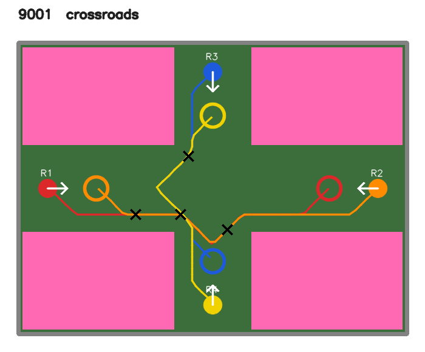
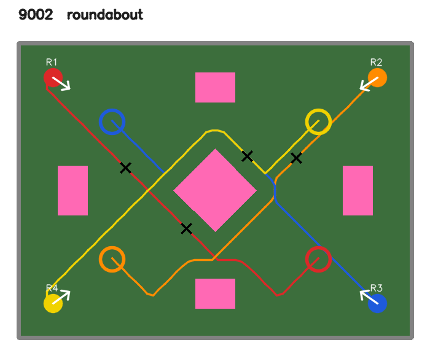
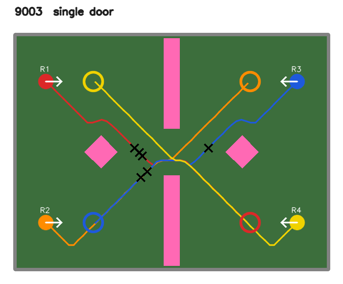
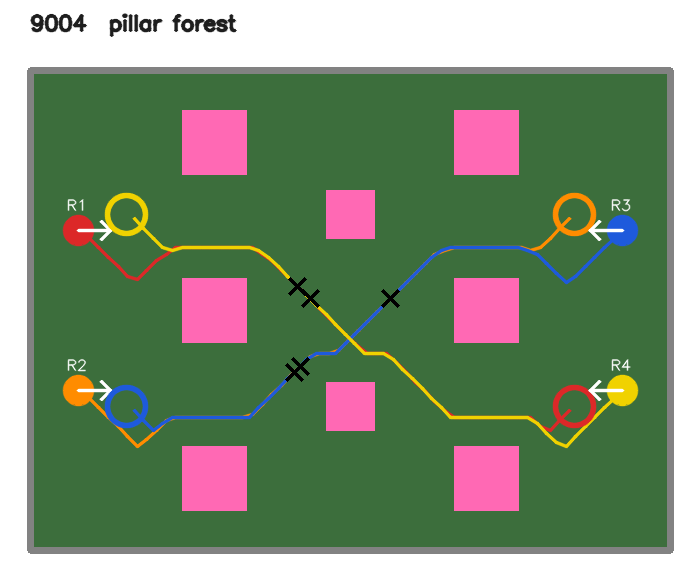
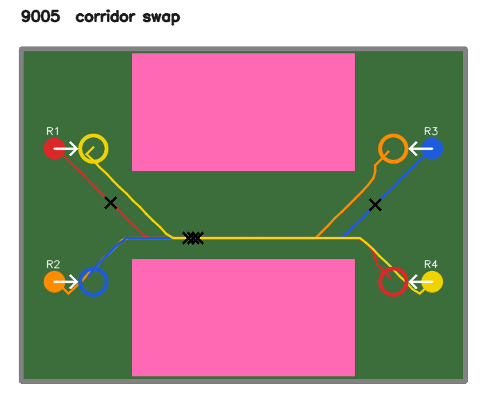

# Designed crossing layouts (stress test for robot-robot avoidance)

Five hand-designed arenas, IDs **9001-9005**, in which the four robots **must** cross each other's paths. The random
layouts (seeds 0-2999) rarely force that: robots often reach their goals without ever meeting. These designs test
collision avoidance between moving robots (dynamic obstacles) under pressure: head-on meetings in corridors, a shared
intersection, a single door, a roundabout and a pillar forest.

Source: `tools/designed_layouts.py`. Status: **exploratory stress test**, added 2026-11-11, after the benchmark. It is
not part of the pre-registered benchmark (`benchmark/PROTOCOL.md`).

## The five designs

Maps below: pink = obstacles (0.4 m tall boxes), filled disc + white arrow = start and heading, ring = goal (same colour as
its robot), line = the robot's shortest collision-free path, black X = a *forced encounter*: two robots' shortest paths
pass within 0.35 m of each other within 4 s of each other, if both drive at 0.15 m/s from the start.

| ID | Name | What makes it hard | Boxes | Shortest paths | Forced encounters |
|---|---|---|---|---|---|
| 9001 | crossroads | Plus-shaped corridors (0.9 m and 0.8 m wide) between four big corner blocks. West/east and north/south swap ends head-on in the same corridor; all four reach the intersection together. | 4 | 2.4-3.4 m | 5 of 6 pairs |
| 9002 | roundabout | Corner starts, goals on the far side; every straight path runs through a central diamond pillar, so all four must go round it at once. Four side posts narrow the ring. | 5 | 3.9-4.0 m | 4 of 6 |
| 9003 | single door | A wall with one 0.6 m door. Two robots on each side swap sides diagonally through the same door; posts in front of the door force a curved approach. | 4 | 3.5-3.6 m | 6 of 6 |
| 9004 | pillar forest | Eight pillars in three staggered columns over the full arena height (no way round). Two streams cross diagonally inside the forest, in 0.5-0.65 m gaps. | 8 | 3.9 m | 6 of 6 |
| 9005 | corridor swap | One straight corridor (0.8 m wide, 2 m long). Two robots at each end must all pass through it, head-on. | 2 | 3.6-3.8 m | 6 of 6 |

| | | |
|---|---|---|
|  |  |  |
|  |  | |

### Rules every design meets (checked by `python3 tools/designed_layouts.py`)
Same acceptance rules as the random generator (`tools/layout.py`): every start and goal free with clearance and in one
connected region (no soft-lock), every goal tag visible to the overhead camera, starts and goals at least 0.25 m from
the walls, start-goal distance at least 1 m, no goal within 0.3 m of another robot's start. Plus at most **8 boxes**,
the limit of the 2D simulator's layout pool (`rl/pool.py`), so the same designs run in 2D and in Gazebo.

### Design history
A first version had a *slalom* (three long walls with alternating gaps) as 9005. Every controller failed it, but by
hitting walls or getting stuck behind them, never by meeting another robot: it tested route planning, not robot-robot
avoidance, so it was replaced by the corridor swap. The first pillar forest left open floor above and below the pillars,
so the shortest paths went round it; it was rebuilt to fill the arena height.

Disclosure (so the design process can be judged): the forest was rebuilt from its path map **before** any controller
ran on it. The slalom was replaced **after** all controllers had been run on it (2D). In the slalom every controller
scored 0/4; in the corridor swap DQN, the rule controller and DWA score 4/4 and PPO 0/4 (2D), so the swap was not
neutral: it lowered PPO relative to the others in the 2D table. No design was changed after seeing Gazebo results.

## How to use them
IDs 9001-9005 work wherever a layout seed is accepted: `tools/layout.py get_layout(seed)` returns the design, any other
seed still gets the random `generate_layout(seed)` (unchanged).
```
bash tools/make_demo.sh 9003 se live                                   # watch one with PPO (video + Gazebo window)
SNR_SPEC=rule SNR_NAME=rule SNR_CAPTION="rule controller (no learning)" bash tools/make_demo.sh 9005 se live
SNR_FIRST=9001 python3 rl/eval_gazebo.py weights/final_policy.npz 9006 0   # all five, Gazebo, PPO (ROS sourced)
cd benchmark && ../.venv/bin/python eval_designed.py                   # all benchmark controllers, 2D, safety layer on/off
python3 tools/designed_layouts.py docs/designed_layouts                # re-check the designs and redraw these maps
```

## Results (2D simulator, one deterministic episode per layout, 20 robots per row)
From `benchmark/eval_designed.py` -> `benchmark/results/designed_2d.json`. Codes per layout: robots 1-4, ok = reached
goal, coll = collision, time = timeout (90 s). With 20 robots, differences of one or two robots are noise.

**Safety layer on**

| Controller | Success | Collision (robot-robot) | Timeout | 9001 | 9002 | 9003 | 9004 | 9005 |
|---|---|---|---|---|---|---|---|---|
| DQN seed 2 | **80%** | 0% (0%) | 20% | 4/4 | 4/4 | 2/4 | 2/4 | 4/4 |
| PPO (deployed) | 70% | 15% (10%) | 15% | 4/4 | 3/4 | 3/4 | 4/4 | 0/4 |
| Rule controller | 70% | 10% (0%) | 20% | 4/4 | 0/4 | 4/4 | 2/4 | 4/4 |
| DWA (privileged map) | 40% | 10% (0%) | 50% | 4/4 | 0/4 | 0/4 | 0/4 | 4/4 |
| Go-to-goal | 30% | 70% (0%) | 0% | 4/4 | 0/4 | 2/4 | 0/4 | 0/4 |
| Tabular Q seed 3 | 20% | 60% (0%) | 20% | 4/4 | 0/4 | 0/4 | 0/4 | 0/4 |

**Safety layer off**

| Controller | Success | Collision (robot-robot) | Timeout |
|---|---|---|---|
| DWA (privileged map) | 60% | 0% (0%) | 40% |
| DQN seed 2 | 30% | 35% (35%) | 35% |
| PPO (deployed) | 20% | **80% (80%)** | 0% |
| Rule controller | 20% | 0% (0%) | 80% |
| Tabular Q seed 3 | 10% | 70% (40%) | 20% |
| Go-to-goal | 0% | 100% (40%) | 0% |

What this shows:
- **The designs do force robot-robot conflicts.** Without the safety layer, 16 of PPO's 20 robots crash, and every one of
  those crashes is into another robot. On the random test layouts the same switch costs PPO 22 points; here it costs 50.
- **With the safety layer on, almost no robot-robot collisions remain** (2 of 120 robot runs across all controllers, both PPO in
  the corridor). The failures move to timeouts (robots wait or circle) and to obstacle hits while dodging.
- **Every design is solvable:** each one is solved 4/4 by at least one controller. With the safety layer on, the
  roundabout, door and forest are each solved 4/4 by only one of the six controllers, the corridor by three. The
  crossroads is the easy one with the layer on (all six 4/4) but the hardest without it (PPO and go-to-goal 0/4).
- **Reactive controllers stall.** The rule controller and DWA time out on the roundabout (the pillar sits straight between
  robot and goal). Without the safety layer the rule controller also times out at the door, in the forest and in the
  corridor, and DWA at the door: robots facing each other keep giving way and nobody goes first.
- The ranking differs from the benchmark (DQN ahead of PPO here). Five layouts are far too few to rank methods; use the
  benchmark for that and these designs to find failure modes.

## Gazebo (PPO, full pipeline: camera, lidar, safety layer on)
`SNR_FIRST=9001 python3 rl/eval_gazebo.py weights/final_policy.npz 9006 0`, run once on 2026-11-11:

| Layout | 9001 crossroads | 9002 roundabout | 9003 single door | 9004 pillar forest | 9005 corridor swap | Total |
|---|---|---|---|---|---|---|
| Robots 1-4 | ok/ok/ok/ok | ok/ok/ok/coll | time/ok/coll/coll | ok/ok/coll/ok | ok/ok/ok/ok | 15/20 ok, 4 coll, 1 time |

Gazebo and 2D disagree on single layouts: the corridor swap is 0/4 for PPO in 2D but 4/4 in Gazebo, the door 3/4 in 2D
but 1/4 in Gazebo. One episode per layout is a sample, not a measurement; small timing differences decide who enters
a corridor or door first.

## Limitations
- **Out of training distribution.** Training uses 3-8 random boxes of 0.15-0.6 m. Long walls, big blocks and corridors
  never appear, so failures here mix two causes: crossing traffic and unfamiliar geometry. The obstacle-collision
  counts mostly come from the second.
- **One deterministic episode per layout** in 2D (no randomised start headings), so no confidence intervals.
- Designed by hand to be hard for the controllers seen so far; a new controller could be tuned to them, so never tune or
  select on these layouts.
